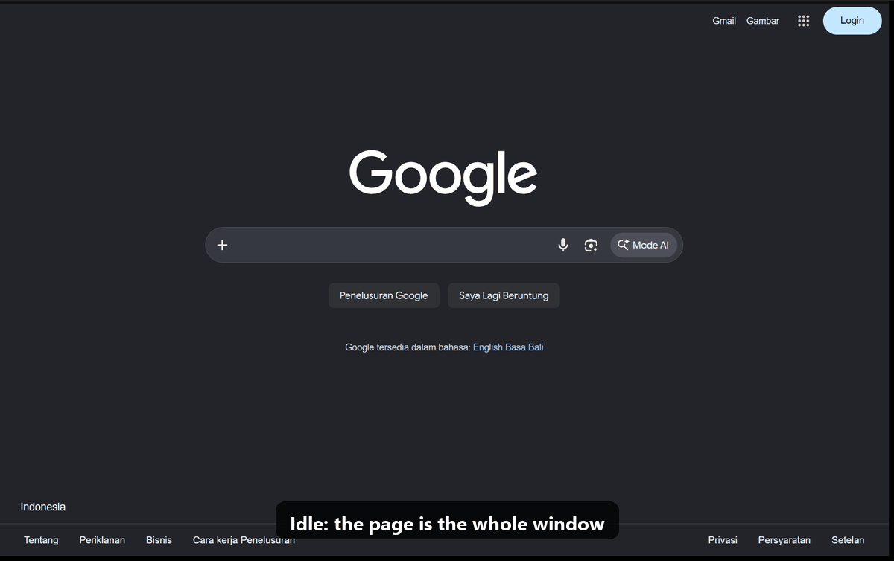
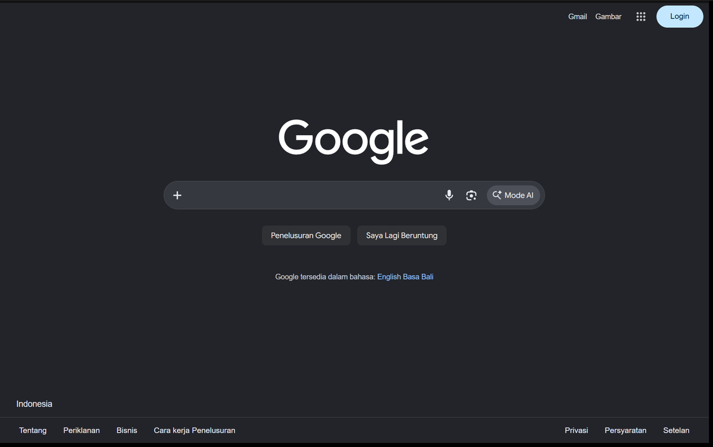
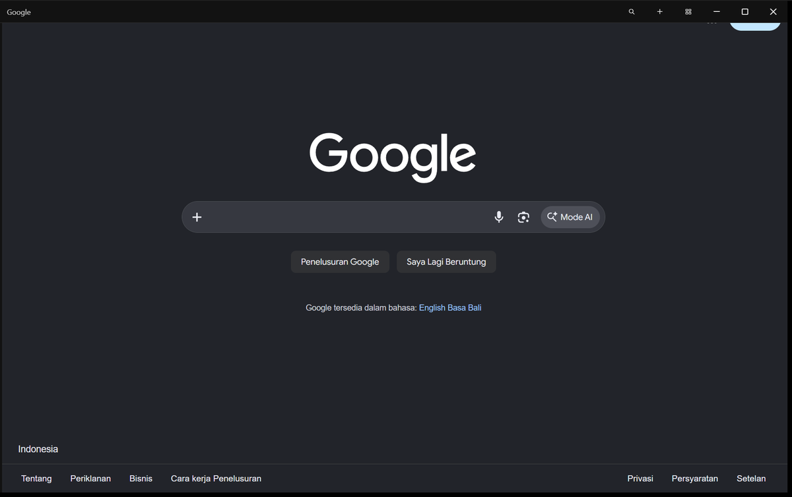
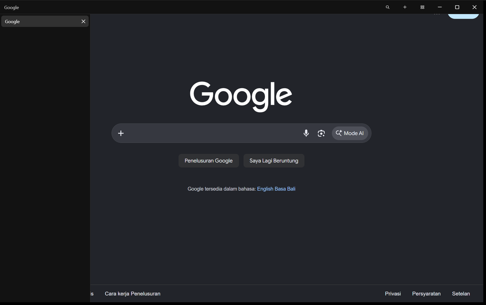
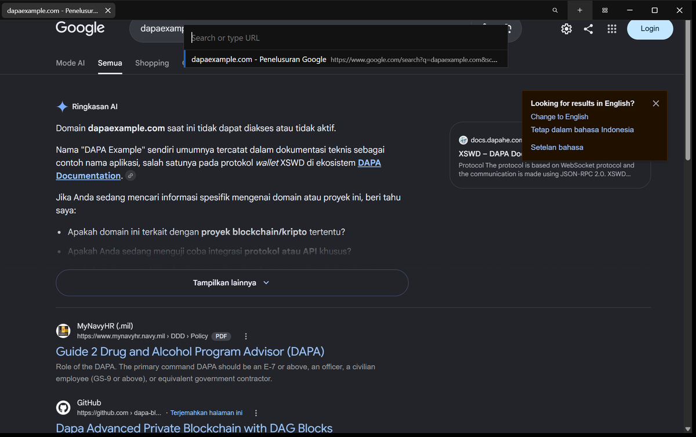

<div align="center">

# Whoz

**A Windows browser that gets out of the way.**

The page fills the whole window. The toolbar and tabs stay hidden until your mouse touches the edge, or stay docked if you prefer.

[Download for Windows](https://github.com/afrizalyogi/whoz-browser/releases/latest) · [Features](#features) · [Compare](#how-it-compares) · [Shortcuts](#keyboard-shortcuts) · [Build](#build-from-source)



<sub>Screenshots show v0.2. The v0.3 toolbar adds back/forward, the address field, bookmarks, downloads, extensions and a menu.</sub>

</div>

## Why Whoz

Most browsers spend 80–130 pixels at the top of the screen on a tab strip, an address bar and a bookmarks bar, all visible all the time. On a laptop that is about 10% of the screen you look at all day.

Whoz shows the web page edge to edge, apart from a 4 px hover strip along the top and left. Point at the top edge and the toolbar slides in. Point at the left edge and your tabs appear. Move away and they leave. If you would rather see them all the time, turn off auto-hide (`Ctrl+Shift+B`) and the page makes room for them.

Whoz is about 1 MB, written in Rust and plain HTML, and runs on the Microsoft Edge WebView2 engine that ships with Windows 10 and 11. Sites render as they do in Edge and Chrome.

## Features

| | |
|---|---|
| **Edge-to-edge pages** | Auto-hide mode keeps only a 4 px hover strip on the top and left edges. |
| **Toolbar** | Back, forward, reload, the address field with a lock icon, bookmark star, zoom level, downloads, extensions, menu and window buttons. Drag empty space to move the window; double-click to maximize. |
| **Vertical tabs, resizable** | Tabs in a sidebar with favicons, loading spinners and full titles. Drag its edge to resize it (180–480 px). Or move tabs to a row on top. |
| **Tab management** | Drag to reorder, pin (pinned tabs sit as icons above the list), mute, duplicate, close others, close below, reopen closed tab (`Ctrl+Shift+T`). Right-click a tab for the menu. |
| **Address bar** | `Ctrl+L` opens a floating bar that suggests open tabs, bookmarks and history as you type. |
| **Bookmarks** | `Ctrl+D` or the star. Folders, search, edit, delete, import from Chrome, Edge or Brave, export to an HTML file any browser reads. |
| **History** | Grouped by day, searchable, delete single entries. Clear browsing data by time range: history, downloads, cookies, cache, passwords, autofill. |
| **Downloads** | A progress ring on the toolbar button, a quick list, and a full page with open, show in folder, cancel and retry. Choose the download folder. |
| **Chrome Web Store extensions** | Open an extension on the Chrome Web Store and press **Add to Whoz**, or paste its link. Toolbar button with each extension's popup. Turn extensions on and off, open their options, remove them, or load an unpacked folder. See [the limits](#extensions). |
| **Sync** | Bookmarks, history and settings sync between PCs through a folder your cloud drive already syncs (OneDrive, Google Drive, Dropbox). See [why not Chrome Sync](#sync). |
| **Developer tools** | `F12` or `Ctrl+Shift+I` opens the Chromium DevTools for the page, extension popups included. |
| **Settings** | Theme (system, light, dark), tab position, auto-hide, sidebar width, startup (restore tabs or home page), home page, search engine (Google, Bing, DuckDuckGo, Brave, Ecosia or custom), tracking prevention level, password saving, autofill, download folder, sync folder. |
| **Private windows** | `Ctrl+Shift+N`. History, cookies, cache and the download list are not kept after the window closes. Bookmarks you add are kept. |
| **Session restore** | Tabs, pinned tabs and window size come back on the next start. Restored tabs load when you first open them. |
| **Popups become tabs** | `target=_blank` and `window.open` (Google and GitHub sign-in included) open as tabs and keep `window.opener`. |
| **Light on memory** | Tabs you are not looking at release memory (`MemoryUsageTargetLevel = Low`). |
| **Default browser** | `install.ps1` registers Whoz with Windows so you can pick it under *Settings › Apps › Default apps*. |

<table>
<tr>
<td><br><sub>Idle: only the page</sub></td>
<td><br><sub>Top edge: toolbar</sub></td>
</tr>
<tr>
<td><br><sub>Left edge: vertical tabs</sub></td>
<td><br><sub>Ctrl+L: address bar</sub></td>
</tr>
</table>

## How it compares

Checked against each browser's documentation and release notes in **November 2026**. Sizes measured on one Windows 11 x64 machine (Chrome 156, WebView2 156).

| | **Whoz** | Chrome | Edge | Firefox | Zen |
|---|---|---|---|---|---|
| Engine | Chromium (Edge WebView2) | Chromium | Chromium | Gecko | Gecko |
| Page fills the whole window by default | ✅ | ❌ | ❌ | ❌ | Optional (Compact Mode) |
| Toolbar hidden until hover | ✅ | ❌ | ❌ | ❌ | ✅ in Compact Mode ([docs](https://docs.zen-browser.app/user-manual/compact-mode)) |
| Vertical tabs | ✅ resizable | ✅ since Apr 2026 ([Google](https://blog.google/products-and-platforms/products/chrome/new-chrome-productivity-features/)) | ✅ since 2021 | ✅ since 136 ([Mozilla](https://connect.mozilla.org/t5/discussions/sidebar-and-vertical-tabs-launch-in-release-136/m-p/89652)) | ✅ |
| Bookmarks, history, downloads | ✅ | ✅ | ✅ | ✅ | ✅ |
| Sync | Folder sync (your cloud drive) | Google account | Microsoft account | Mozilla account | Mozilla account |
| Extensions | Chrome Web Store, with [limits](#extensions) | Chrome Web Store | Edge Add-ons, Chrome Web Store | AMO | AMO |
| DevTools | ✅ Chromium DevTools | ✅ | ✅ | ✅ | ✅ |
| Download size | **476 KB** zipped | ~1 GB installed | ~1.8 GB installed | — | — |
| Platforms | Windows | Windows, macOS, Linux | Windows, macOS, Linux | Windows, macOS, Linux | Windows, macOS, Linux |
| Open source | ✅ GPL-3.0 | Chromium only | ❌ | ✅ | ✅ |

**About the size row.** Whoz is small because it reuses WebView2, which Windows already installed (about 870 MB on the test machine). It does not use less memory per page than Edge; it runs the same engine.

### Sync

Chrome Sync is not available to other browsers: Google [removed third-party Chromium browsers' access to it on 15 March 2021](https://blog.chromium.org/2021/01/limiting-private-api-availability-in.html). Whoz syncs through a folder instead. Pick the same OneDrive, Google Drive or Dropbox folder on each PC under *Settings › Sync*; Whoz merges `whoz-sync.json` there when it starts, when it closes, and when you press *Sync now*. Deletes sync too. Passwords and cookies are not synced, and the file is not encrypted, so choose a folder only you can read.

To bring your Chrome bookmarks over, use *Settings › Import bookmarks › Chrome*.

### Extensions

Whoz installs extensions from the Chrome Web Store and runs them in WebView2, Microsoft's embedded Edge engine. WebView2's extension support is narrower than Chrome's:

- Content scripts, background service workers, popups and options pages work, so ad blockers, password managers and page tools generally do.
- APIs that act on the browser window, such as `chrome.tabs`, `chrome.windows`, side panels and keyboard commands, are not provided by WebView2 ([WebView2Feedback #3853](https://github.com/MicrosoftEdge/WebView2Feedback/issues/3853)). Extensions that depend on them partly work or fail.
- Whoz downloads the package from Google's update server, unpacks it and loads it as an unpacked extension that keeps its store ID. Updates do not install automatically yet; reinstall to update.

### Who should use Whoz

- You want the most screen for the page.
- You use the keyboard and want a short menu instead of many.
- You want a second, separate browser for one web app or one account.

### Who should stay with Chrome, Edge, Firefox or Zen

- You need Google or Microsoft account sync, or extensions that rely on `chrome.tabs` or side panels.
- You use macOS or Linux.
- You want a mature browser with security teams and years of hardening behind it. Whoz is a young shell; the engine under it is updated by Microsoft with Windows.

## Keyboard shortcuts

| Keys | Action |
|---|---|
| `Ctrl+L`, `Alt+D`, `F6`, `Ctrl+Space` | Address bar |
| `Ctrl+T` / `Ctrl+Shift+T` | New tab / reopen closed tab |
| `Ctrl+N` / `Ctrl+Shift+N` | New window / new private window |
| `Ctrl+W`, `Ctrl+F4` | Close tab (closing the last tab quits) |
| `Ctrl+Tab`, `Ctrl+Shift+Tab`, `Ctrl+PgDn`, `Ctrl+PgUp` | Next / previous tab |
| `Ctrl+1` … `Ctrl+8`, `Ctrl+9` | Tab N / last tab |
| `Ctrl+D` | Bookmark this page |
| `Ctrl+H`, `Ctrl+J`, `Ctrl+Shift+O` | History, downloads, bookmarks |
| `Ctrl+Shift+Delete` | Clear browsing data |
| `Ctrl+Shift+B` | Auto-hide toolbar on/off |
| `Alt+Home` | Home page |
| `F12`, `Ctrl+Shift+I` | Developer tools |
| `Alt+←`, `Alt+→`, `F5`, `Ctrl+F`, `Ctrl+P`, `Ctrl +`/`-`/`0` | Back, forward, reload, find, print, zoom |
| `F11` | Full screen |
| `Alt` + drag anywhere | Move the window |

In the address bar, text with a dot (`example.com`) opens as a site and anything else searches. Start with `?` to force a search (`? node.js`). `whoz://settings`, `whoz://history`, `whoz://bookmarks`, `whoz://downloads` and `whoz://extensions` open Whoz pages.

## Install

1. Download `whoz-browser-windows-x64.zip` from [Releases](https://github.com/afrizalyogi/whoz-browser/releases/latest) and unzip it.
2. Run `whoz.exe`. To add Whoz to the Start menu and the list of default browsers, run `install.ps1` (per user, no admin rights).

`whoz.exe https://example.com` opens that URL. `whoz.exe --private` opens a private window.

**Requirements:** Windows 10 or 11, x64, with the Microsoft Edge WebView2 Runtime. Windows 11 includes it; on Windows 10 get it from [Microsoft](https://developer.microsoft.com/microsoft-edge/webview2/) if Whoz reports it missing. Extensions need a recent WebView2 Runtime; Whoz tells you if yours has no extension support.

Your data lives in `%LOCALAPPDATA%\WhozBrowser`: `profile\` (cookies, passwords, cache), `extensions\`, and JSON files for settings, bookmarks, history and downloads.

## Build from source

Needs [Rust](https://rustup.rs) with the MSVC toolchain.

```powershell
git clone https://github.com/afrizalyogi/whoz-browser
cd whoz-browser
cargo run --release      # build and run
cargo test               # parsing, merging, CRX and shortcut tests
.\package.ps1            # dist\whoz-browser\ + zip
.\scripts\manual-test.ps1  # guided manual test with a Markdown report
```

### How it works

```
tao window (frameless)
├── tab WebViews ........ one per tab, created when first shown, only the active one visible
├── extension popup ..... a small WebView under the toolbar while open
└── ui.html WebView ..... toolbar, tabs, address bar, menus; transparent,
                          clipped with SetWindowRgn to the shapes on screen
```

The overlay is a normal web page clipped to the toolbar, the sidebar and any open menu. Everywhere else, clicks go straight to the page. Shortcuts come from WebView2's `AcceleratorKeyPressed` event, so they work whichever page has focus. Whoz pages are served from `https://whoz.localhost/` by a custom protocol and call a small JSON API that other sites cannot reach (see [SECURITY.md](SECURITY.md)).

| File | What |
|---|---|
| [`src/main.rs`](src/main.rs) | Window, tabs, toolbar commands, extensions, downloads, page API, shortcuts |
| [`src/store.rs`](src/store.rs) | Settings, bookmarks, history, downloads, folder sync |
| [`src/ext.rs`](src/ext.rs) | Chrome Web Store download, CRX unpacking, manifests |
| [`src/win.rs`](src/win.rs) | Win32 helpers |
| [`src/ui.html`](src/ui.html) | Toolbar, tabs, address bar, menus |
| [`src/pages.html`](src/pages.html) | Settings, history, bookmarks, downloads, extensions pages |

## Roadmap

Ideas, not promises. Open an issue to vote or discuss.

- Extension auto-update
- Tab groups and split view
- Find bar in the toolbar
- Per-site permissions page
- Encrypted sync file

## Contributing

Bug reports, ideas and pull requests are welcome. Read [CONTRIBUTING.md](CONTRIBUTING.md) first; the short version is: keep it small, run `cargo test` and `cargo clippy --all-targets -- -D warnings`, and describe how you tested.

Security issues: follow [SECURITY.md](SECURITY.md) instead of opening a public issue.

## License

[GNU General Public License v3.0 or later](LICENSE). You can use, study, share and change Whoz; if you distribute a changed version, you share its source under the same license.

Made by [PT Aryatama Teknologi Digital](https://github.com/afrizalyogi). Built on [tao](https://github.com/tauri-apps/tao) and [wry](https://github.com/tauri-apps/wry) from the Tauri project. Interface inspired by Apple's Human Interface Guidelines and [Zen Browser](https://github.com/zen-browser).
